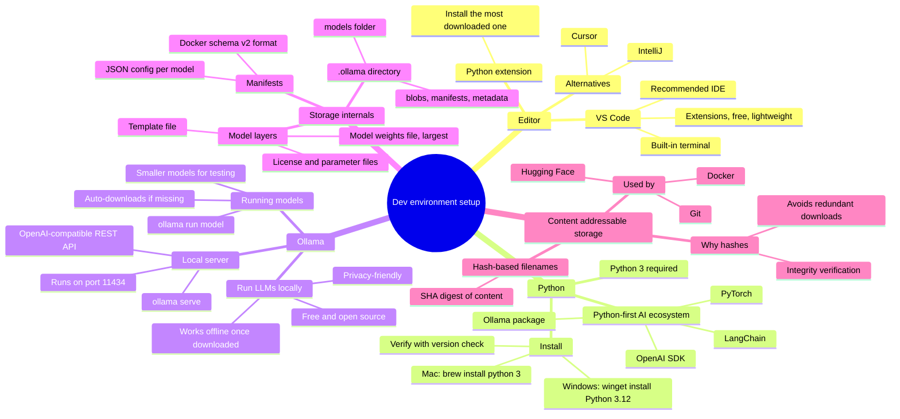
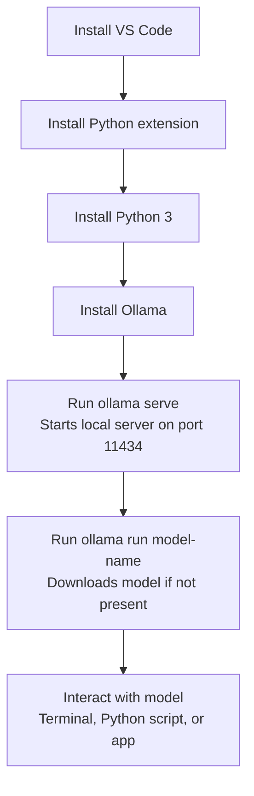
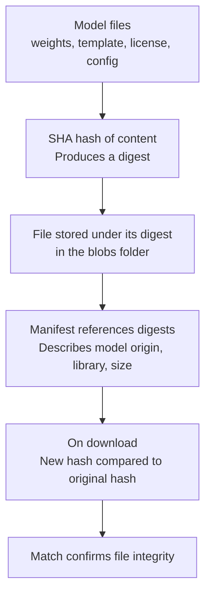
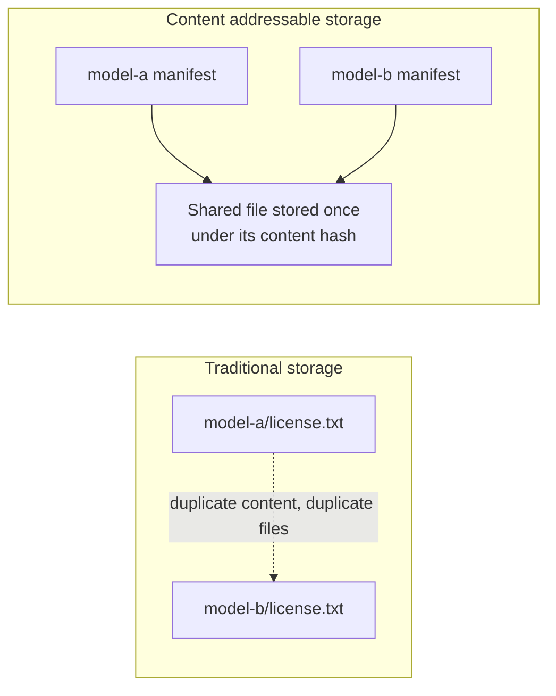

# Development Environment Setup: VS Code, Python, and Ollama

Setting up a local AI/ML development environment, and how Ollama runs and stores large language models.

## Mind map

## Setup flow

## How Ollama stores and verifies models

## Content addressable storage: naming by content, not by name

## Summary

### Setting up the editor

Visual Studio Code is the recommended IDE for AI and machine learning work, chosen for its extension ecosystem, free availability, lightweight footprint, and built-in terminal. Other IDEs such as IntelliJ or Cursor can be used instead. Within VS Code, installing the Python extension (the one with the highest download count) adds language support. VS Code installs on Windows, Mac, or Linux directly from the official website.

### Setting up Python

Python 3 is the required language, since the major AI tools and libraries, including the OpenAI SDK, LangChain, PyTorch, and the Ollama package, are Python-first. It installs on Windows with `winget install Python 3.12`, or on Mac with `brew install python 3` (Homebrew must already be installed). Installation can be verified by checking the version in a terminal.

### What Ollama is

Ollama is a free, open-source platform for downloading, running, and interacting with large language models locally. It works offline once a model is downloaded, keeps data private, and is designed to be approachable for beginners.

### Running the local server

Running `ollama serve` starts a local server on port 11434 (chosen because the digits visually resemble the letters "LLAM"). This server exposes an OpenAI-compatible REST API, so interacting with local models feels similar to using a hosted service like ChatGPT, Gemini, or Claude. The server's status can be checked by visiting `127.0.0.1:11434` in a browser.

### Running models

Models are downloaded and run with `ollama run <model-name>`. If the model isn't already on the machine, this command downloads it automatically before starting it. Model names often include a size indicator, such as "4B," referring to the number of parameters (the learned weights from training that the model uses to predict the next token). Smaller models, around 3-4 billion parameters, are recommended for local testing and learning, since larger models can slow down a system unnecessarily.

### How models are stored

Downloaded models live in a hidden `.ollama` directory in the home folder, inside a `models` subfolder organized into `blobs`, `manifests`, and metadata. The manifest format matches Docker's schema version 2, and each manifest is a JSON file describing the model's origin, library, and size. The actual files, the model weights (the largest, often a few GB), a small template file defining message formatting, and separate license and configuration files, are stored in the `blobs` folder.

### Why files are stored by hash

Every file's content is run through a hash function (SHA) to produce a digest, and that digest becomes the filename. This serves two purposes:

1. **Integrity verification**: after downloading a large file, the system re-hashes it and compares the result to the expected hash, confirming the file wasn't corrupted or altered in transit. Even a tiny change in content produces a completely different hash.
2. **Avoiding duplicate storage**: if multiple models share an identical file, such as the same license text, that file produces the same hash and is stored only once rather than duplicated.

### Content addressable storage (CAS)

This hash-based approach is called content addressable storage: files are addressed by what they contain rather than by a name, so identical content is automatically deduplicated. It's a technique shared by Ollama, Docker, Git, and Hugging Face, and understanding it is useful background for explaining why these tools work the way they do.

### Where this leads

With the editor, Python, and Ollama set up, the next phase of work is building an AI assistant in Python.

## Key takeaways

| Concept | In one line |
| --- | --- |
| VS Code | Recommended IDE: free, lightweight, extensible, built-in terminal |
| Python 3 | Required language; the AI/ML ecosystem is Python-first |
| Ollama | Free, open-source tool to run LLMs locally, offline and private |
| ollama serve | Starts a local server on port 11434 with an OpenAI-compatible API |
| ollama run | Downloads (if needed) and runs a specified model |
| Model parameters | Learned weights used to predict the next token; smaller models suit local testing |
| .ollama directory | Stores models in blobs, manifests, and metadata subfolders |
| Manifest | JSON file in Docker schema v2 format describing a model's origin and size |
| Hash/digest | SHA-based content fingerprint used as a filename |
| Why hash-based storage | Verifies file integrity and avoids storing duplicate content |
| CAS | Content addressable storage: address files by content hash, not by name; used by Ollama, Docker, Git, Hugging Face |