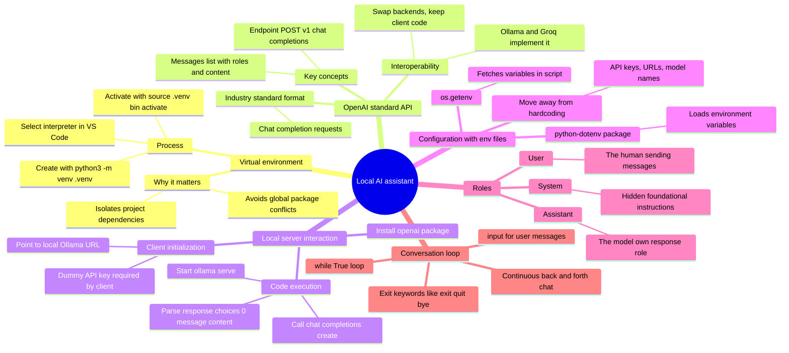
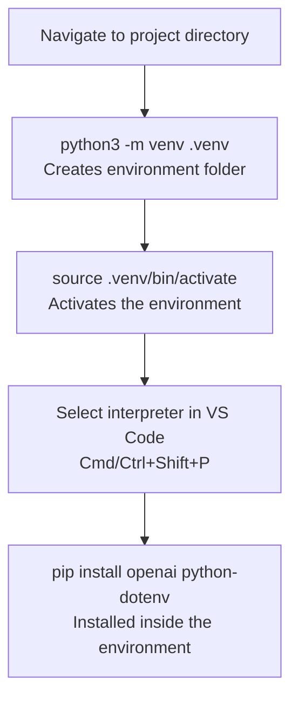
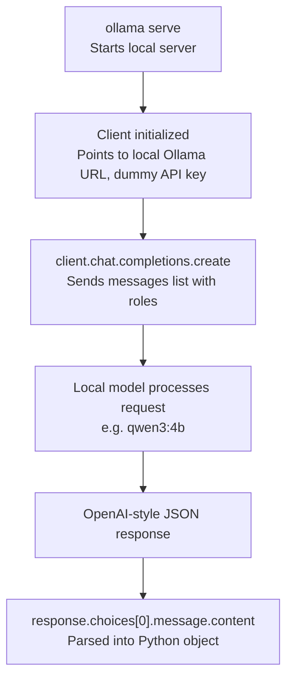
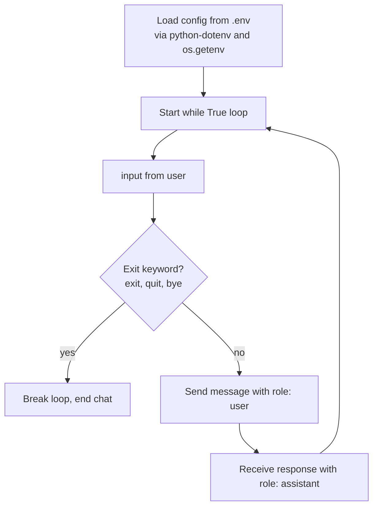

# Building a Local AI Assistant: Environments, APIs, and Conversation Loops

Setting up an isolated Python environment, talking to a local LLM through the OpenAI-standard API, and turning that into a continuous chatbot with configuration and roles handled properly.

## Mind map

## Environment setup flow

## From request to response

## Building the conversational loop

## Summary

### Why a virtual environment

Installing Python packages globally risks version conflicts between different projects. A virtual environment isolates each project's dependencies, keeping them separate and reproducible.

The process: run `python3 -m venv .venv` in the project directory to create the environment, then activate it with `source .venv/bin/activate` on Mac/Linux (the terminal prompt then shows `(.venv)`). In VS Code, use `Cmd+Shift+P` (or `Ctrl+Shift+P`), search for "Python: Select Interpreter," and choose the interpreter inside the `.venv` folder so the editor uses the correct environment.

### The OpenAI standard API style

OpenAI's chat completion request format has become the de facto industry standard for interacting with LLMs. Tools like Ollama and Groq implement the same standard, which means the backend model can be swapped out while the client-side code stays the same.

Key pieces of the standard:

- **Endpoint**: `POST /v1/chat/completions`.
- **Messages**: a list of conversation turns, each with a role (such as `user` or `assistant`) and content.

### Talking to a local server

With the virtual environment active, `pip install openai` adds the client library. The client is configured to point at the local Ollama server (`http://127.0.0.1:11434/v1`), and a dummy API key is passed since local servers don't require authentication but the OpenAI client still requires the field to be set.

To run a full exchange:

1. Start the server with `ollama serve`.
2. Call `client.chat.completions.create()`, specifying the local model (for example, `qwen3:4b`).
3. The OpenAI client converts Ollama's JSON response into a Python object; the reply text is read from `response.choices[0].message.content`.

### Managing configuration with .env files

Hardcoding sensitive values like API keys, server URLs, and model names directly in code is fragile and insecure. The `.env` file standard moves these settings out of the script. The `python-dotenv` package (installed inside the virtual environment) loads these variables, and `os.getenv()` fetches them within the Python script, keeping the code cleaner and safer to share.

### Understanding roles

Roles let the model distinguish who is speaking in a conversation:

- **User**: the human sending messages.
- **Assistant**: the model's own responses, used to separate its output from the user's input.
- **System**: hidden, foundational instructions that shape the AI's behavior, a concept that goes deeper in later work.

Printing the `role` field from a response confirms the model's reply is correctly labeled `assistant`.

### Building a conversation loop

A `while True` loop turns a single request-response exchange into a real chatbot. The loop continuously listens for user input via `input()`, sends it to the model, and prints the reply, until the user types an exit command such as `exit`, `quit`, or `bye`. Combined with `.env`-based configuration, this produces a dynamic, back-and-forth conversational assistant.

## Key takeaways

| Concept | In one line |
| --- | --- |
| Virtual environment | Isolates project dependencies to avoid version conflicts |
| python3 -m venv .venv | Creates a project-local environment folder |
| source .venv/bin/activate | Activates the environment in the terminal |
| OpenAI API standard | `POST /v1/chat/completions` with a messages list; adopted by Ollama, Groq, and others |
| Local client setup | Point the OpenAI client at the local Ollama URL with a dummy API key |
| ollama serve | Starts the local model server before making API calls |
| Response parsing | `response.choices[0].message.content` holds the reply text |
| .env + python-dotenv | Keeps API keys, URLs, and model names out of hardcoded code |
| os.getenv() | Reads environment variables into the script |
| Roles | user (human), assistant (model), system (hidden instructions) |
| Conversation loop | `while True` + `input()` + exit keywords builds a continuous chatbot |