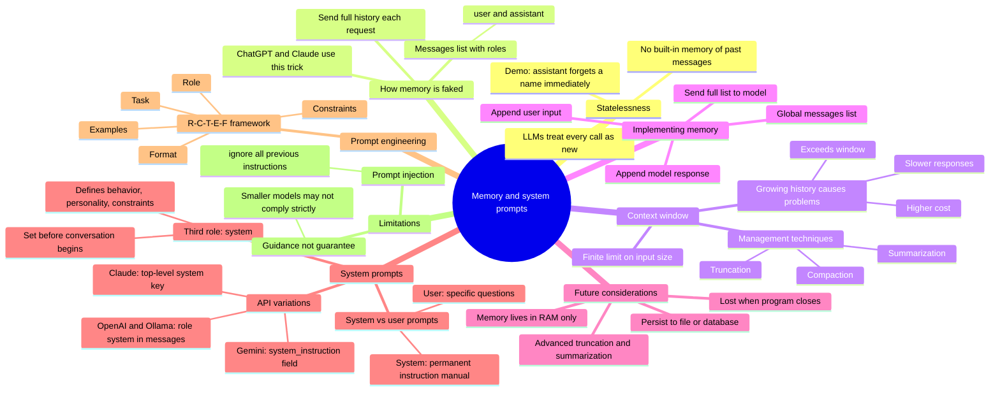
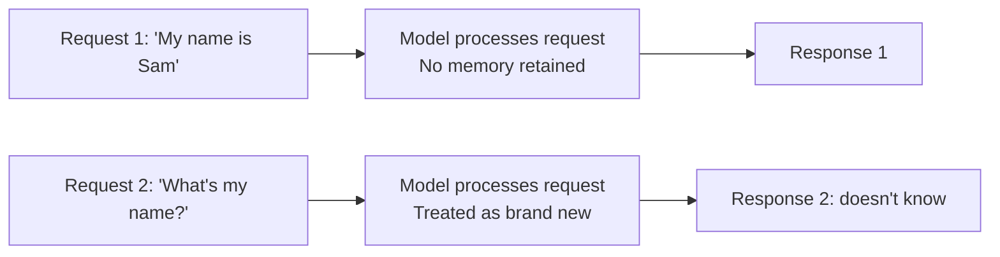
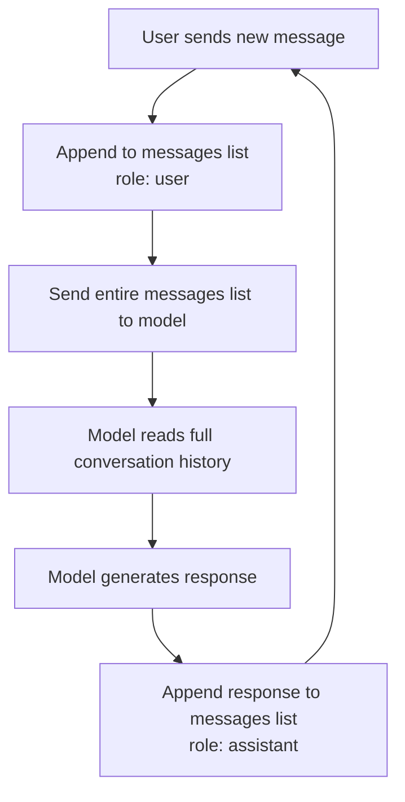
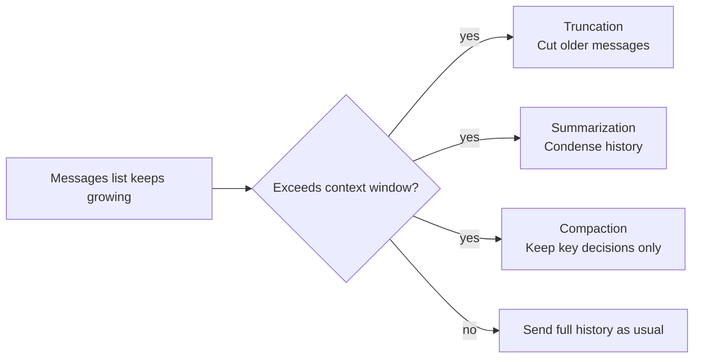
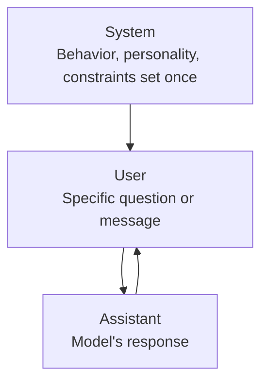

# Conversation Memory and System Prompts

Why LLMs forget everything between calls, how chat memory is faked by resending history, and how system prompts give an assistant a consistent personality and rules.

## Mind map

## Why the assistant forgets

## How memory is simulated

## Managing a growing context window

## Where the system role sits

## Summary

### Why AI assistants forget

LLMs are stateless by design: every API call is treated as a brand-new interaction, with no inherent memory of earlier messages. Without specific programming, an assistant can't recall something a user said moments earlier, like their name, because the model has no memory to draw on between calls.

### How memory actually works

Tools like ChatGPT and Claude appear to remember a conversation, but the trick is that they resend the entire conversation history as a list of messages with every new request. Each message in that list is tagged with a role, either `user` (the human) or `assistant` (the AI), so the model can follow the sequence of the dialogue.

### The context window and its limits

Every LLM has a finite context window: a limit on how much text it can process at once. As a conversation list grows, it can exceed this window, push up costs, or slow down responses. Common techniques to manage this include:

- **Truncation**: cutting off older messages.
- **Summarization**: condensing the history into a shorter form.
- **Compaction**: keeping only key decisions and information.

### Implementing memory

A basic chat loop gains memory by maintaining a global `messages` list. For every user input, the code appends the user's text to the list, sends the entire list to the model, and then appends the model's response back into the list, so the full history travels with each request.

### What's still missing

Current memory lives only in RAM and is lost when the program closes. Natural next steps are persisting conversation history to a file or database, and implementing more advanced truncation or summarization strategies to manage the growing context window over time.

### The system role

Beyond `user` (the person asking questions) and `assistant` (the model's response), the `system` role lets a developer define the assistant's behavior, personality, and constraints before the conversation even begins.

### System prompts vs user prompts

User prompts are for specific questions in the moment. System prompts act as a permanent instruction manual, shaping the model's tone and rules for the entire conversation.

### How providers handle system instructions

Different APIs implement this differently:

- **OpenAI / Ollama**: a `role: "system"` message placed at the top of the message list.
- **Gemini**: a separate `system_instruction` field.
- **Claude**: a top-level `system` key.

In practice, adding a system prompt to an existing project means prepending a dictionary with `role: "system"` to the start of the message history.

### Ingredients of a good prompt: R-C-T-E-F

Effective instructions tend to include:

- **Role**: who the model should act as (e.g., an interviewer).
- **Constraints**: limits to respect (e.g., respond under 20 words).
- **Task**: what needs to be achieved.
- **Examples**: templates to follow, also known as few-shot prompting.
- **Format**: the structure of the desired output.

Context (the background of the situation) rounds this out as well, giving the model what it needs to apply the role and task correctly.

### Limitations of system prompts

Two things to keep in mind:

- **Prompt injection**: users may try to override system instructions with phrases like "ignore all previous instructions."
- **Guidance, not guarantee**: system prompts steer the model but don't guarantee compliance; smaller models (such as a 4B parameter model) may not strictly follow complex constraints.

## Key takeaways

| Concept | In one line |
| --- | --- |
| Stateless LLMs | Every API call is treated as new, with no built-in memory |
| Simulated memory | Full conversation history is resent with each request |
| Roles in history | Messages are tagged `user` or `assistant` to preserve sequence |
| Context window | The finite amount of text a model can process per request |
| Truncation | Cuts older messages to stay within the context window |
| Summarization | Condenses history into a shorter form |
| Compaction | Retains only key decisions and information |
| messages list | Append user input, send full list, append model response |
| Memory persistence gap | Current memory lives in RAM only and is lost on exit |
| System role | Sets behavior, personality, and constraints before the conversation |
| System vs user prompt | System = permanent rules; user = specific in-the-moment questions |
| API differences | OpenAI/Ollama use a system message; Gemini uses system_instruction; Claude uses a system key |
| R-C-T-E-F | Role, Constraints, Task, Examples, Format: ingredients of a good prompt |
| Prompt injection | Users may try to override system instructions directly |
| Guidance not guarantee | Smaller models may not strictly follow system prompt constraints |