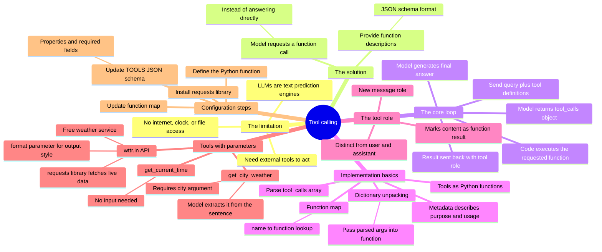
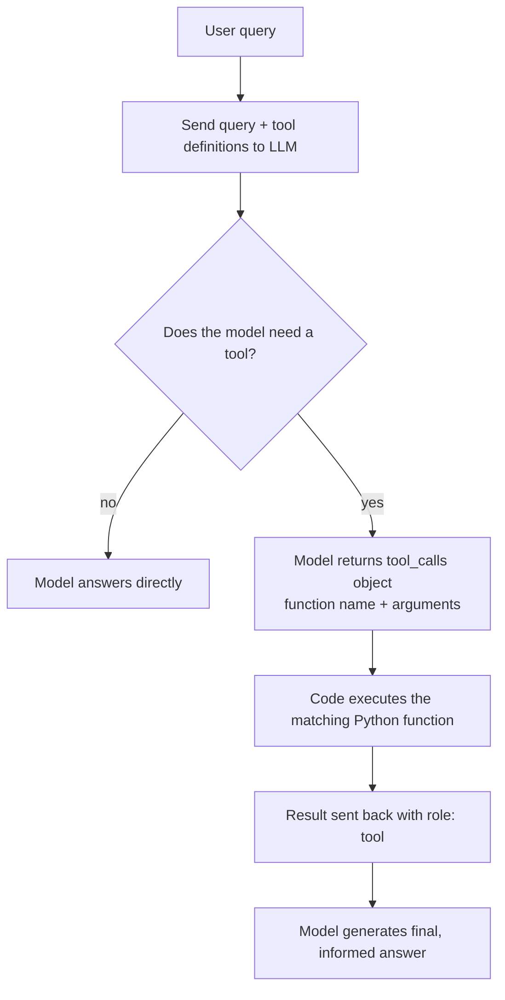
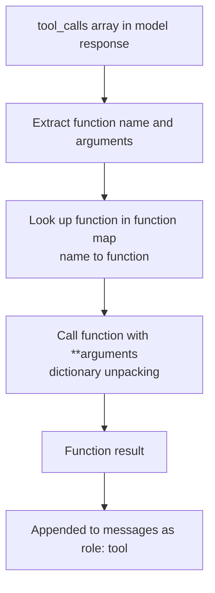
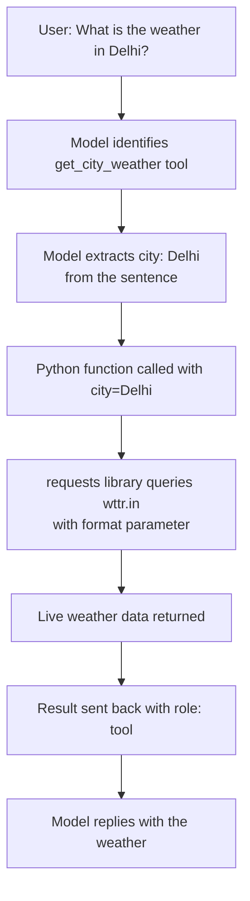

# Tool Calling: Giving AI Assistants Real-World Abilities

How LLMs call external functions to act beyond text prediction, from basic tool calling to tools that take parameters and hit live APIs.

## Mind map

## The tool calling loop

## From tool call to Python execution

## Adding a parameterized tool: weather lookup

## Summary

### The limitation tool calling solves

LLMs are fundamentally text-prediction engines. They can't access the internet, a clock, or local files on their own. Without a way to reach outside their own text generation, questions like "what time is it" or "what's the weather" are simply beyond them.

### The solution: tool calling

The model is given a list of function descriptions in JSON schema format. When a user asks something that needs external data, the LLM doesn't try to answer directly, it requests a specific function call instead, leaving the actual execution to the surrounding code.

### The core loop

1. The developer sends the user's query along with the available tool definitions to the LLM.
2. The LLM recognizes it needs a tool and returns a response containing a `tool_calls` object.
3. The Python code executes the requested function.
4. The function's result is sent back to the LLM using the `tool` role, and the model uses it to generate a final, informed answer.

### Defining and handling tools

Tools are written as ordinary Python functions, paired with metadata (a JSON schema) that tells the model what each tool does and when to use it. When a response comes back, the code parses the `tool_calls` array, extracts the function name and arguments, and uses a dictionary that maps tool names to functions to execute the right one dynamically.

### The tool role

A new messaging role, `tool`, marks content as the result of a function execution rather than something a user typed or the assistant generated directly. This keeps the model's view of the conversation accurate: it can tell the difference between what it said, what the user asked, and what a function returned.

### Dictionary unpacking

The `**` operator in Python unpacks the parsed arguments from the model's tool call directly into the matching function call, so the arguments the model extracted map cleanly onto the function's parameters without manual reassignment.

### Result: a working time tool

With this loop in place, the assistant can answer questions like "What time is it now?" by calling a local `get_current_time` tool, proving the tool-calling loop works end to end.

### Extending to tools with parameters

The next step is a tool that needs input: `get_city_weather` requires a `city` argument, unlike the parameter-free `get_current_time`. The model extracts the city name directly from the user's sentence and fills in the argument dynamically.

### Weather API integration

The free `wttr.in` API is used to fetch live weather data. A URL is constructed with specific format parameters (such as `format=3` for a compact output), and Python's `requests` library handles the actual HTTP call.

### Wiring up the new tool

Adding `get_city_weather` means:

1. **Define the function**: a Python function that uses `requests` to query the weather API.
2. **Update the tool schema**: add the `city` property and mark it required in the `TOOLS` JSON schema so the model knows to supply it.
3. **Update the function map**: link the string tool name to the actual Python function.
4. **Install dependencies**: `pip install requests` to bring in the HTTP library.

### Testing the parameterized tool

With this wired up, the assistant correctly handles queries like "What is the weather of Delhi right now?", selecting the right tool, calling it with the extracted city argument, and parsing the live result into a response.

## Key takeaways

| Concept | In one line |
| --- | --- |
| LLM limitation | Models are text predictors with no native access to real-world data |
| Tool calling | Giving the model function descriptions it can request instead of answering directly |
| tool_calls object | The model's response containing which function to call and with what arguments |
| tool role | Marks a message as a function's result, distinct from user and assistant |
| Function map | Dictionary linking a tool's string name to its actual Python function |
| Dictionary unpacking (**) | Passes the model's parsed arguments directly into the function call |
| get_current_time | A parameter-free tool proving the basic tool-calling loop |
| get_city_weather | A parameterized tool requiring a city argument extracted from user text |
| wttr.in | Free weather API queried via the `requests` library |
| TOOLS JSON schema | Defines each tool's properties and required fields for the model |
| Setup steps | Define function, update schema, update function map, install dependencies |