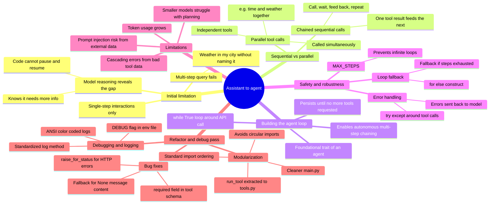
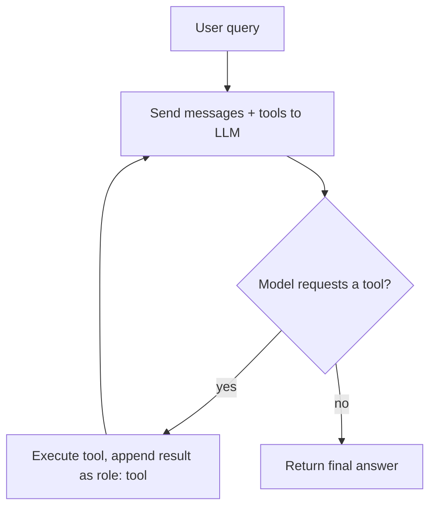
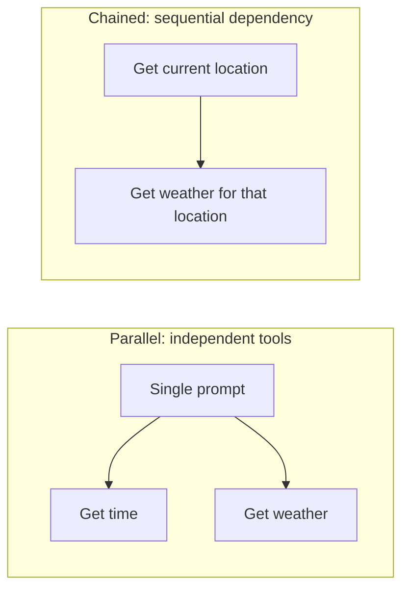
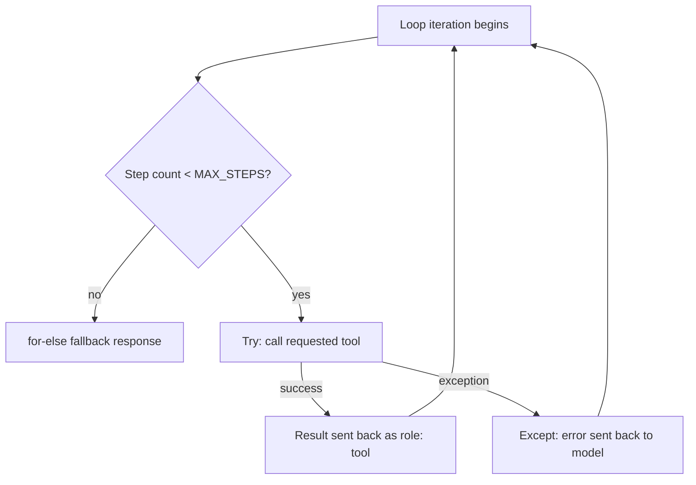
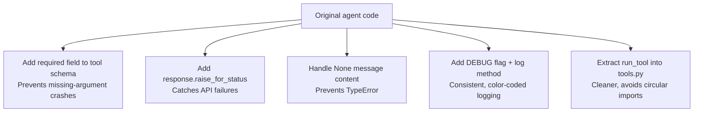

# From Assistant to Agent: Chained Tool Calling and Refactoring

How a single-step tool-calling assistant becomes an agent capable of chaining multiple tool calls, with the safety, debugging, and modularity work that makes it reliable.

## Mind map

## The agent loop

## Parallel vs chained tool calls

## Safety around the loop

## Refactor pass: from working to reliable

## Summary

### The limitation that motivated the change

The assistant previously handled only single-step interactions. A multi-step query, such as asking for the weather in "my city" without naming it, caused it to fail outright. Looking at the model's internal reasoning showed that the LLM could recognize it needed more information, like the user's current location, but the surrounding code had no way to pause, call a tool for that missing piece, and resume with the result.

### Parallel vs chained tool calls

Two different needs emerged:

- **Parallel tool calls**: independent tools that can be called at the same time to answer different parts of a single prompt, such as asking for the time and the weather together.
- **Chained (sequential) tool calls**: needed when one tool's result is a prerequisite for the next. The assistant has to call a tool, wait for its result, feed that result back to the LLM, and repeat until there's enough information for a final answer.

### Building the agent loop

The fix was to move the API call inside a `while True` loop that keeps running until the model stops requesting tools. This structure lets the assistant chain multiple steps on its own, which is the foundational trait that turns a simple assistant into an agent.

### Safety and robustness

Running an open-ended loop needs guardrails:

- **MAX_STEPS**: a variable that caps how many iterations the loop can run, preventing it from looping indefinitely.
- **Error handling**: tool-calling logic is wrapped in `try-except` blocks, so if a tool fails, the error is sent back to the model instead of crashing the program, letting the agent handle or report the issue gracefully.
- **Loop fallback**: Python's `for-else` construct provides a fallback response if the model uses up all allowed steps without reaching a final answer.

### Limitations to keep in mind

Chaining tool calls introduces new risks: token usage grows with every step, a bad result from one tool can cascade into errors down the chain, smaller models often struggle with multi-step planning, and reading external data through tools carries an inherent risk of prompt injection.

### Why this matters

This loop-based implementation is the first real step toward a fully autonomous AI agent, one that perceives its environment through tool results and makes its own decisions toward a goal, rather than just answering a single question.

### Fixing critical bugs

A follow-up pass focused on reliability rather than new features, starting with three fixes:

- **Tool schema**: adding a `required` field to the tool definition so the AI reliably provides necessary arguments, preventing crashes from missing data.
- **HTTP error handling**: adding `response.raise_for_status()` so API failures are caught and handled gracefully instead of failing silently or crashing.
- **None content handling**: adding a fallback so a `TypeError` doesn't occur when the model's message content comes back empty.

### Debugging and logging

A `DEBUG` flag in the `.env` file lets developers toggle detailed logs without touching the core logic. A dedicated `log()` method in `Utilities/utility.py` standardizes all debug output, and ANSI escape codes (such as `\033[90m`) color-code the logs (grey, in this case) to make the agent's internal decision-making easier to follow while debugging.

### Modularization

The `run_tool()` logic was pulled out into its own `tools.py` file, keeping `main.py` cleaner and avoiding circular imports. Import ordering was also tidied up, separating standard library imports, third-party packages, and local modules, following common industry convention.

## Key takeaways

| Concept | In one line |
| --- | --- |
| Single-step limitation | The original assistant couldn't handle queries needing a missing piece of information |
| Parallel tool calls | Independent tools called at once for different parts of a prompt |
| Chained tool calls | One tool's output feeds into the next tool call, repeated until done |
| Agent loop | A `while True` loop around the API call enables autonomous multi-step chaining |
| MAX_STEPS | Caps loop iterations to prevent infinite running |
| try-except around tools | Catches tool failures and reports them back to the model instead of crashing |
| for-else fallback | Provides a response if the step limit is reached without a final answer |
| Chaining risks | Rising token cost, cascading errors, weaker planning in smaller models, prompt injection |
| required schema field | Ensures the model supplies necessary tool arguments |
| raise_for_status() | Catches and surfaces HTTP/API failures |
| None content fallback | Prevents a TypeError when the model returns empty content |
| DEBUG flag + log() | Toggleable, standardized, color-coded debug logging |
| run_tool() in tools.py | Keeps main.py clean and avoids circular imports |