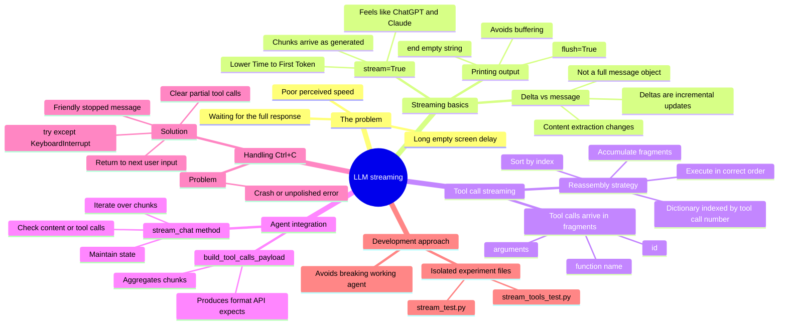
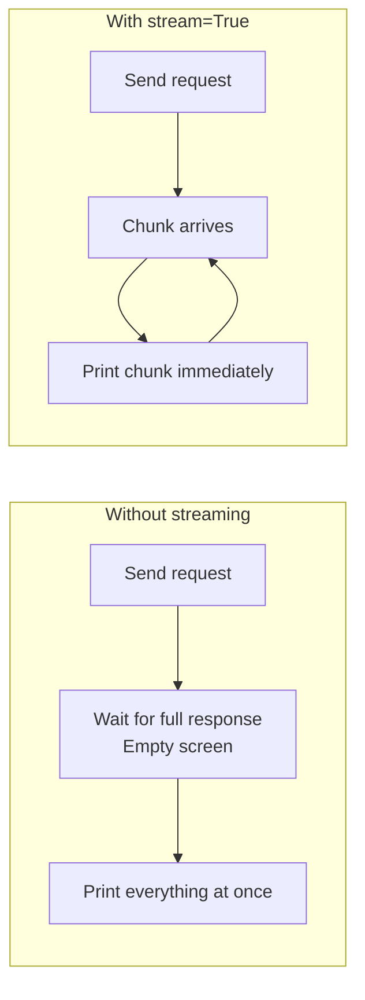
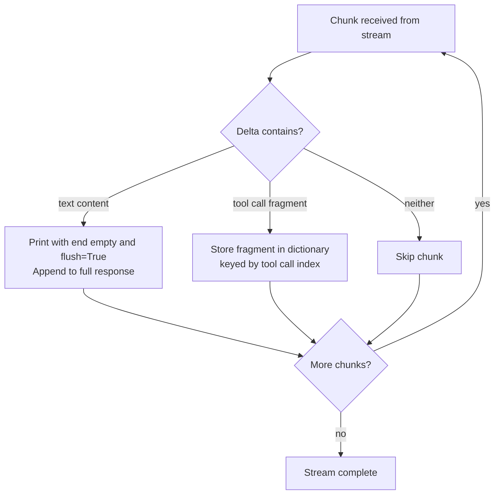
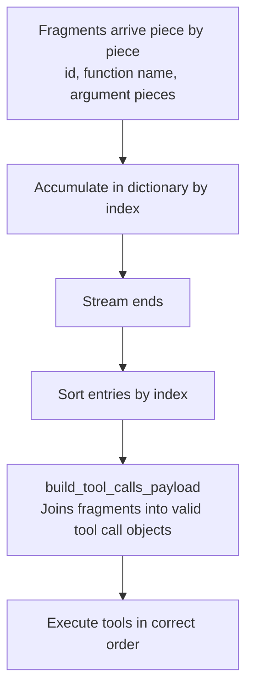
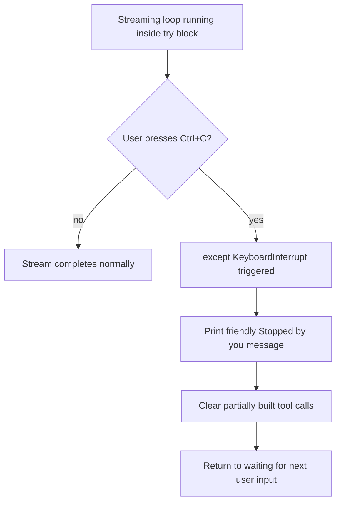

# LLM Streaming: Real-Time Responses in an AI Agent

How to stream model output chunk by chunk instead of waiting for a full response, how to reassemble streamed tool calls, and how to handle Ctrl+C gracefully.

## Mind map

## Non-streaming vs streaming

## Processing a stream

## Reassembling streamed tool calls

## Graceful interruption

## Summary

### Why streaming matters

Without streaming, the agent waits for the model to finish its entire output before showing anything, leaving the user staring at an empty screen. Streaming instead displays text as it's generated, reducing the Time to First Token (TTFT) and making the agent feel much faster, similar to the experience in ChatGPT or Claude.

### Streaming basics

Passing `stream=True` in the API call makes the model return data in small chunks as it generates them, rather than one complete response. The agent processes and prints each chunk as it arrives.

### Delta vs message

When streaming, the API returns deltas, which are incremental updates, rather than a full message object. This changes how the code extracts content: instead of reading a finished message, it reads a small piece from each chunk's delta.

### Printing chunks correctly

To display streamed text smoothly on a single line, Python's `print` needs `end=""` (so each chunk doesn't start a new line) and `flush=True` (so output isn't buffered and appears in real time).

### Streaming tool calls

When an agent makes a tool call, the model streams that information too, in fragments: pieces of the id, function name, and arguments arrive separately. These need to be glued back together into a valid tool call object before execution. The approach is to build a dictionary indexed by tool call number, accumulate fragments until each call is complete, and then sort by index so tools run in the correct order.

### Safe experimentation

Rather than risk breaking the working agent, the streaming logic is first built and tested in isolated experiment files, such as `stream_test.py` and `stream_tools_test.py`, and only then integrated.

### Integrating streaming into the agent

Integration centers on `stream=True` in the agent's API calls, plus a new `stream_chat()` method that handles the streaming logic: iterating over chunks, checking for content or tool calls, and maintaining state as the response builds up. Because streaming breaks traditional message handling, a custom `build_tool_calls_payload()` function aggregates tool call chunks into the format the API expects.

### Handling Ctrl+C

Pressing Ctrl+C mid-generation used to crash the application or show an unpolished error. The streaming loop is now wrapped in a `try-except` block that catches `KeyboardInterrupt`. When triggered, the agent prints a friendly "Stopped by you" message, clears any partially built tool calls so they don't leak into the next turn, and returns gracefully to waiting for the next user input.

## Key takeaways

| Concept | In one line |
| --- | --- |
| Streaming | Show output chunk by chunk instead of waiting for the full response |
| stream=True | API flag that makes the model return incremental chunks |
| TTFT | Time to First Token: streaming reduces it, improving perceived speed |
| Delta | An incremental update in a chunk, rather than a full message object |
| end="" and flush=True | Print chunks on one line, in real time, without buffering |
| Streamed tool calls | Arrive as fragments (id, name, arguments) that must be reassembled |
| Index-keyed dictionary | Accumulates tool call fragments, then sorted by index for ordered execution |
| stream_chat() | Method handling chunk iteration, content/tool-call checks, and state |
| build_tool_calls_payload() | Aggregates tool call chunks into the format the API expects |
| KeyboardInterrupt handling | try-except catches Ctrl+C, prints a friendly message, and clears partial tool calls |
| Experiment files | Isolated test scripts that avoid breaking the working agent |